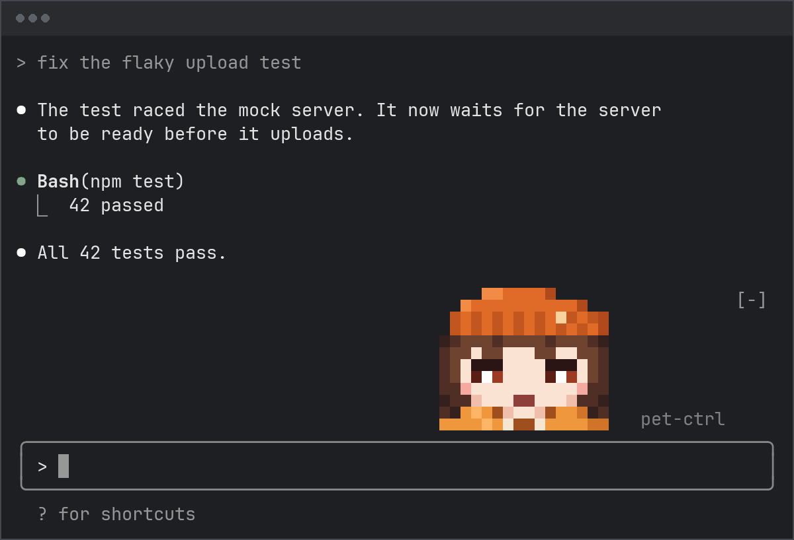

# lany-cc-pets

A small animated pet that lives above Claude Code's prompt and keeps you
company while Claude works. Now and then it says one short line to you
about how things are going, in a one-word personality you give it.



## Install

This repository is its own Claude Code marketplace. Add it by its GitHub
name, then install the plugin from it:

```sh
claude plugin marketplace add lany42/lany-cc-pets
claude plugin install lany-cc-pets@lany-cc-pets
```

Inside Claude Code, `/plugin marketplace add lany42/lany-cc-pets` and
`/plugin install lany-cc-pets@lany-cc-pets` do the same. To try the pet
for one session without installing it, clone the repository and start
`claude --plugin-dir /path/to/lany-cc-pets`.

Start a new Claude Code session and the pet appears above the prompt. Its
classic looks work in any terminal. The optional experimental looks show
only in a terminal wide enough for them (elsewhere a classic look stands
in): the braille ones need a font with braille characters (JetBrainsMono
Nerd Font Mono, Adwaita Mono and Noto Sans Symbols 2 have them), and the
pixel and painted ones a truecolor terminal.

## Using it

| Command | What it does |
| --- | --- |
| `/pet` | Opens **pet-control**, its settings pane, with a **Pet it** button and a chat bar. The dim **pet-ctrl** button beside the pet opens it too. |
| `/pet <word>` | Gives it a personality: one word, or words joined by hyphens (`/pet snarky`, `/pet wide-eyed`). |
| `/pet list` | Opens a gallery of its looks, each one playing; pick one there. |
| `/pet as <look>` | Wears the look with that id (shown under each look in the gallery), e.g. `/pet as rubber-duck`. |
| `/pet btw <message>` | Says something to it; it answers in its bubble. |
| `/pet quiet`, `/pet chatty` | Stops or restarts its remarks; it still answers when you talk to it. |
| `/pet remember`, `/pet forget` | Lets it remember what you say to it, from now on and up to 12 exchanges back, or makes it forget. |
| `/pet window` | Opens or closes the pet window, a pane of its own with more room. |
| `/pet experimental`, `/pet classic` | `experimental` adds the braille, pixel-art and painted looks and shows a test line for your font; `classic` turns them off and puts your last classic look back on. |
| `/pet seed [<word>]` | For a grown look (bonsai, jelly, flock): says what it grew from, or grows a new one from a word (`new` picks one). |
| `/pet hide`, `/pet show` | Hides or shows the pet. |

The pet in the picture is Momiji: `/pet experimental`, then `/pet as momiji`.
Your settings carry over from one session to the next.

What you do in pet-control, chat included, stays out of your conversation
with Claude. A typed `/pet` command leaves its own line in the transcript,
as every slash command does, so Claude can read what you wrote after
`/pet btw`.

### A session with the pet

Picking a look, talking to it, quieting it, putting it away and giving it
a window of its own. Each `>` is a command you type, `toast` a notice
Claude Code shows, and `pet` the line in the pet's speech bubble. The
pet's lines are written fresh each time; these are examples.

```text
> /pet as rubber-duck
  toast  Explaining a bug to a rubber duck has been sound advice since The
         Pragmatic Programmer, and this one nods along.
  pet    Quack. Ready to hear about every bug, line by line.

> /pet btw the flaky test finally passed
  pet    Told you it was the clock. Enjoy the green while it lasts.

> /pet quiet
  toast  Your pet will keep quiet unless you talk to it.

> /pet hide
  toast  Your pet is napping out of sight.

> /pet show
  toast  Your pet is back.

> /pet window
         The pet window opens: a pane of its own, with room for the
         pet to move and talk.
```

## The looks

60 looks: 34 classic ones drawn in ASCII, and 26 experimental ones.
Each is listed here by the id `/pet as` takes, in the gallery's order.

The classic looks, in any terminal:

| Kind | Looks |
| --- | --- |
| The default | `cat` |
| Objects and machines with a soul | `toaster`, `chatter-teeth`, `typewriter`, `lighthouse` |
| Elements, weather and growing things | `flytrap`, `iceberg`, `titania`, `sourdough`, `campfire` |
| Mythic, cosmic and surreal | `black-hole`, `galaxy`, `walking-hut`, `many-eyes` |
| Abstract, typographic and mathematical | `merge-conflict`, `glider`, `replacement-char` |
| Developer folklore | `rubber-duck`, `yak`, `reflog-ghost` |
| Mascots of the tools | `clawd`, `ferris`, `python` |
| So cute it's a little scary | `axolotl`, `water-bear`, `fruit-bat`, `poodle-moth`, `sea-bunny`, `crab`, `eyeberry`, `sea-angel`, `rag-doll`, `love-slime`, `jumping-spider` |

The experimental looks, after `/pet experimental`:

| Kind | Looks |
| --- | --- |
| Braille miniatures, drawn dot by dot | `luna-moth`, `clockwork-scarab`, `hoard-dragon`, `hummingbird`, `cuttlefish` |
| Grown from a seed word, simulated a tick at a time | `bonsai`, `jelly`, `flock` |
| Wide scenes, a creature living in each | `koi-pond`, `owl-night`, `deep-water`, `tokyo-cat`, `sunken-dreamer`, `prairie-town` |
| Braille pets that break the frame | `looper`, `peek`, `nightcat`, `stray` |
| Pixel art | `hamster`, `tree-frog`, `momiji-pixel`, `sakura-pixel`, `chameleon` |
| Painted characters | `momiji`, `sakura`, `pomelo` |

The pet window (`/pet window`) is a pane of its own with more room: a
scene fills it with more sky and water, and a pet gets rows to talk in.

## On its own

Shortly after a turn ends it may say a line about how things are going for
you. During a long turn it chimes in rarely, and it stays silent after a
turn you stop with Esc. To write a line it reads the latest part of your
session; each line, like each answer, is one small Sonnet call at low
effort, and a quiet or hidden pet makes no calls on its own.
[PRIVACY.md](PRIVACY.md) says exactly what it sends and keeps; `/pet quiet`
stops its remarks and keeps it on screen. It dozes after
10 minutes without you, sparkles when a failing test suite goes green or a
commit lands, and makes room when Claude Code's task list crowds the bottom
of the screen.

## Source

The canonical repository is <https://git.colorized.life/lany-cc-pets.git>;
<https://github.com/lany42/lany-cc-pets> is its mirror.

## Troubleshooting

- **No pet, or a classic look in place of the one you picked.** A look
  draws only where the terminal has room for it; with too little, a
  classic look stands in, and with none, nothing shows. Widen the
  terminal or give it more rows, or open `/pet window` for a pane of its
  own. A hidden pet comes back with `/pet show`.
- **Braille looks show boxes or hollow rings.** Your font has no braille
  characters. `/pet experimental` shows a test line, `⣿⣀⠉⢸⡇`, that should
  be dots. Use a font that has them (JetBrainsMono Nerd Font Mono,
  Adwaita Mono and Noto Sans Symbols 2 do), or go back with
  `/pet classic`.
- **Classic looks with joined or misshapen characters.** A font with
  programming ligatures, such as Fira Code, draws runs like `##`, `->`,
  `__` or `...` as one shape, and the art breaks. Turn ligatures off in
  your terminal, or use the font's plain version (Fira Mono for Fira
  Code, JetBrains Mono NL for JetBrains Mono).
- **Pixel or painted looks in wrong or banded colors.** They need a
  truecolor (24-bit) terminal. Check that your terminal, and tmux or
  screen if you use one, passes truecolor through, or wear a classic or
  braille look.

For anything else, open an issue as [SECURITY.md](SECURITY.md) describes.

## License

Apache-2.0. See [LICENSE](LICENSE).
